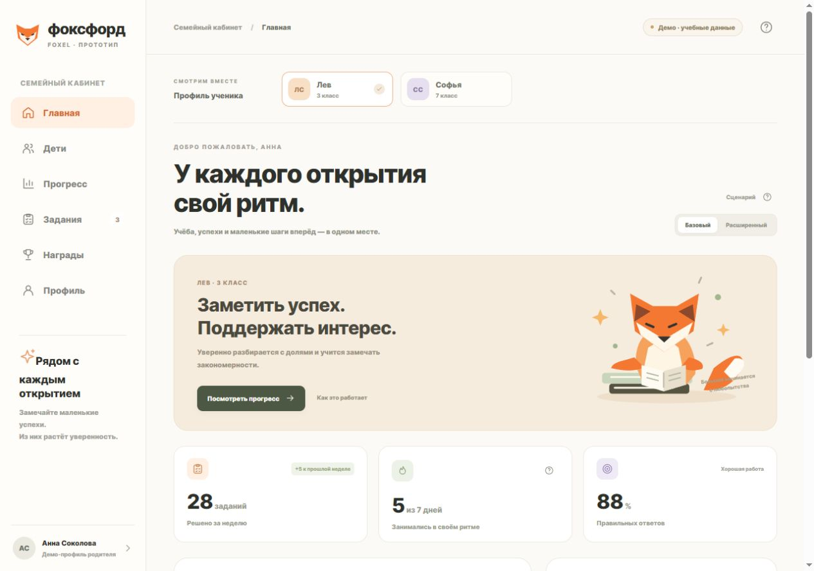

# MyBoxFoxel

Локальный прототип мини-приложения для канала Фоксфорда в MAX: кабинет с профилем, детьми, учебным прогрессом и достижениями. Он помогает проверить интерфейс и путь к интеграции до подключения реальных систем.

**По умолчанию это симуляция.** Все учебные данные вымышлены. Приложение не обращается к API Фоксфорда, не привязывает реальные профили и не отправляет сообщения в MAX. Сервер умеет отдельно проверять подписанные данные запуска MAX, если задан токен своего бота; это ещё не авторизация в Фоксфорде.

Проект подготовлен для размещения в GitHub как исходный код; локальный Git-репозиторий создан. Удалённый репозиторий и публичное размещение пока не настроены.

## Запуск

Требуется **Node.js 22 или новее**. Внешних зависимостей, установки пакетов и сборки нет.

```sh
npm start
```

Откройте [http://localhost:4173](http://localhost:4173). Процесс по умолчанию слушает только локальный адрес `127.0.0.1`.

В Windows можно также запустить `start-local.cmd` двойным щелчком из папки проекта и открыть этот адрес в браузере. Окно сервера нужно оставить открытым на время просмотра.

```sh
npm test
npm run check
```

`npm test` запускает тесты через встроенный `node --test`. `npm run check` проверяет синтаксис JavaScript. Успешные локальные проверки не заменяют проверку внутри клиентов MAX и не подтверждают интеграцию с Фоксфордом.



[Мобильный вид](docs/screenshots/mobile-home.jpg) · [Что проверено](docs/validation.md)

## Режимы и границы

| Возможность | Состояние |
| --- | --- |
| Локальные экраны и переключение демонстрационных состояний | Реализованы на вымышленных данных |
| Демонстрационные профили, дети, учебные показатели и достижения | Локальные данные в `dist/demo-data.js` |
| Проверка подписи и свежести данных запуска MAX | Серверный код, включается при `MAX_BOT_TOKEN` |
| Собственная короткоживущая сессия после проверки MAX | Cookie HttpOnly, хранение в памяти сервера |
| Привязка реального профиля Фоксфорда | Не реализована |
| Получение занятий, прогресса и достижений Фоксфорда | Не реализовано; нужен согласованный API |
| Бот, публикация в канале, HTTPS-хостинг и модерация MAX | Не создаются локальным запуском |
| Автоматические уведомления и рассылки | Не реализованы |

Демонстрационные кнопки и состояния не изменяют реальные аккаунты. В браузере без данных запуска MAX официальный SDK не требуется. Если URL содержит параметры запуска `WebAppData`, клиент может подключить официальный MAX Bridge и отправить исходную строку на собственный сервер для проверки. Реальный запуск требует своего зарегистрированного бота и HTTPS-размещения.

## Настройки

Все параметры задаются в окружении процесса. Сервер не требует файла `.env` и не должен получать секреты из статических файлов.

| Переменная | По умолчанию | Назначение |
| --- | --- | --- |
| `HOST` | `127.0.0.1` | Адрес, на котором слушает сервер |
| `PORT` | `4173` | Порт HTTP-сервера |
| `MAX_BOT_TOKEN` | Не задана | Токен своего бота для проверки подписи MAX; при отсутствии endpoint проверки возвращает 503 |
| `COOKIE_SECURE` | `false` | Для локального HTTP — `false`; при реальном HTTPS-размещении установить `true` |

Для демонстрации достаточно значений по умолчанию. Не коммитьте токен и не помещайте его в `dist`. Реальное HTTPS-размещение должно сохранять обращения клиента и API на одном origin либо отдельно реализовывать согласованную политику доступа.

## Структура

```text
MyBoxFoxel/
├── dist/                    # Статический интерфейс, ES modules, без сборки
│   ├── index.html           # Стартовая страница
│   ├── app.js               # Экраны и демонстрационные действия
│   ├── demo-data.js         # Вымышленные данные для симуляции
│   ├── max-bridge.js        # Загрузка Bridge и запрос проверки MAX
│   └── styles.css           # Адаптивное оформление
├── src/
│   └── max-auth.mjs          # Проверка данных запуска MAX
├── server.mjs               # Локальный сервер, API проверки MAX и сессии
├── package.json             # Команды запуска и проверок, без dependencies
└── docs/
    ├── architecture.md      # Компоненты, API и контракты будущей интеграции
    ├── max-integration.md   # MAX, авторизация и путь к запуску
    └── uchi-reverse-engineering.md  # Разбор предоставленных материалов Учи.ру
```

## Что нужно для подключения Фоксфорда

Сначала нужен подтверждённый механизм авторизации Фоксфорда, права доступа родителя/ученика и контракты получения данных. Затем — серверная привязка `max_user_id ↔ foxford_user_id` через одноразовый код или другой согласованный механизм авторизации. Сопоставление только по имени, произвольному ID или номеру телефона не реализует проверку доступа к ребёнку.

В MAX мини-приложение привязывается к боту, а канал ведёт в него по диплинку. Техническая схема и проверенные официальные ссылки — в [интеграции MAX](docs/max-integration.md). Компоненты и контракты — в [архитектуре](docs/architecture.md).

Исходный JavaScript стороннего сервиса, личные ссылки запуска и данные чужого сеанса в проект не включены. Визуальная концепция и предложенные экраны не являются доказательством внутреннего устройства приложения Учи.ру.
