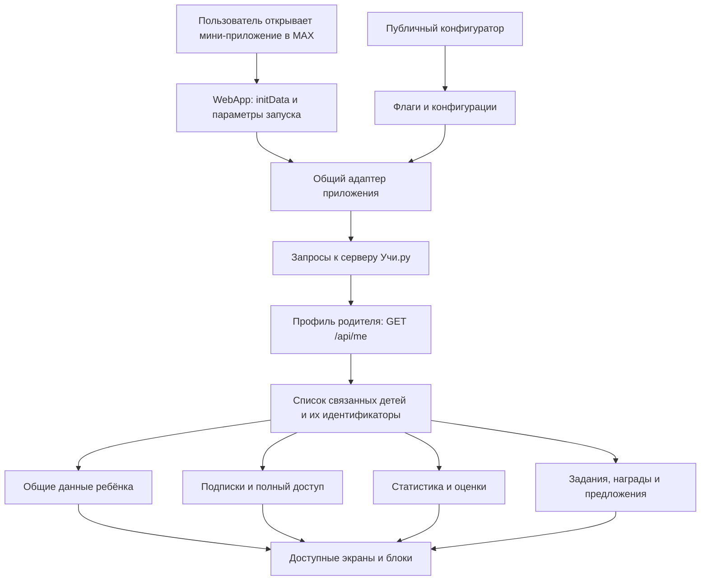

# Как устроено мини-приложение Учи.ру для родителей

Дата исследования: **1 ноября 2026 года**. Документ описывает конкретную публичную сборку и наблюдения в одном пользовательском аккаунте. Это функциональный и архитектурный разбор для проектирования MyBoxFoxel, без копирования чужого приложения.

## Основной вывод

Учи.ру использует общее веб-приложение для **MAX, Telegram и VK**. Мессенджер открывает веб-интерфейс и предоставляет контекст запуска. Профиль родителя, дети, занятия, подписки, награды, задания, игры и покупки обслуживаются собственными сервисами Учи.ру.

Видимые пользователю главный экран и профиль — часть более широкого приложения. В коде есть статистика, домашние задания от родителя и учителя, достижения и портфолио, подписки, истории, игры, сезонная «Школомания», магазин подарков, материалы «Плюс» и предложения Тетрики. Доступность зависит от серверных флагов, класса ребёнка, свойств аккаунта, подписок и способа входа. Наличие экрана в сборке не означает, что он включён для текущего пользователя.

Для MyBoxFoxel применима сама схема: **мини-приложение MAX → собственный сервер → подтверждённая связь с аккаунтом Фоксфорда → данные ребёнка**. Данные обучения должны приходить из систем Фоксфорда; MAX не становится их источником. Прототип может воспроизводить этот путь с демонстрационными данными. Для настоящего подключения понадобятся согласованный способ входа Фоксфорда и доступные ему серверные интерфейсы.

## Источники и границы проверки

| Источник | Что он позволяет установить | Чего он не доказывает |
|---|---|---|
| [Публичный JavaScript приложения](https://uchi.ru/parents-miniapp/assets/index-IeGVhami.js) | Компоненты, маршруты, клиентские запросы, адаптеры мессенджеров, формулы отображения и условия видимости | Реализацию серверов, действующие настройки всех аккаунтов, успешное выполнение каждого запроса |
| Два скриншота пользователя | Состав главного экрана и профиля в момент снимка | Полный набор разделов и точные источники чисел |
| Просмотр работающего интерфейса в аккаунте пользователя | Реально открывшиеся страницы, текущие подписи, пустые состояния и тарифное окно | Поведение других аккаунтов, платные операции, скрытые серверные проверки |
| Документация MAX: [введение](https://dev.max.ru/docs/webapps/introduction/), [Bridge](https://dev.max.ru/docs/webapps/bridge/), [проверка данных запуска](https://dev.max.ru/docs/webapps/validation/) | Общую модель веб-приложения и интерфейсов SDK | Конкретную серверную реализацию Учи.ру |

Исследованная сборка имеет размер **1 651 728 байт** и SHA-256:

```text
04f859fbbc66ca3969becf2de4fb2cef686a9d290182984b5302394747c71511
```

Первоначально переданный файл с общим именем `main.js` оказался вставкой Kaspersky: в нём есть `AvNs`, адрес `gc.kis.v2.scr.kaspersky-labs.com` и служебные модули проверки страниц. Функциональные выводы ниже получены из настоящей публичной сборки `index-IeGVhami.js`, а не из этого файла.

Код анализировался как текст. При статическом анализе запросы к закрытым API не выполнялись. Просмотр интерфейса проводился отдельно. Покупки, отправка домашних заданий, заявки партнёрам, изменение профиля и выход из аккаунта не использовались как способ проверки. Исходный bundle, скриншоты с данными аккаунта, подписанные ссылки запуска и `initData` в репозиторий MyBoxFoxel не включаются.

В документе используются три уровня уверенности:

- **Подтверждено кодом** — в сборке есть соответствующая реализация или явный вызов.
- **Проверено в интерфейсе** — действие или экран наблюдались в исследованном аккаунте.
- **Вывод** — объяснение, согласующееся с кодом, но требующее серверной документации или дополнительных наблюдений.

## На чём собрано приложение

| Часть | Подтверждение | Уверенность |
|---|---|---|
| React **18.3.1** | В библиотеке задано `version = '18.3.1'`; приложение монтируется через `createRoot` | Подтверждено кодом |
| React Router **7.18.2** | `window.__reactRouterVersion = '7.18.2'`, дерево маршрутов и общий basename | Подтверждено кодом |
| MobX и mobx-react-lite | Store-объекты, наблюдаемые данные, реакции, React observer; внутренняя версия MobX state — 6 | Подтверждено кодом; точная версия пакета MobX не установлена |
| Vite | Runtime-событие `vite:preloadError`, переменные `VITE_*`, предзагрузка ресурсов | Подтверждено кодом; версия Vite не установлена |
| CSS Modules | Имена классов вида `Scoring-module_*`, `PortfolioPage-module_*` | Подтверждено сборкой |
| Клиенты API на основе `fetch` | Структурированные генераторы запросов, проверки обязательных параметров и HTTP-ответов | Подтверждено кодом; конкретный генератор не установлен |
| DOMPurify **3.4.12** | Версия в библиотеке очистки HTML | Подтверждено кодом |
| Sentry **9.47.1** | Константа версии SDK и инициализация production-конфигурации | Подтверждено кодом |
| CloudPayments | Загрузка `widget.cloudpayments.ru/bundles/checkout`, `window.cp.Checkout`, создание криптограммы | Подтверждено кодом; реальная оплата не проверялась |

Это обычное клиентское веб-приложение с несколькими страницами внутри одного интерфейса. По клиентской сборке нельзя надёжно назвать язык и фреймворк серверов, базу данных, облако, механизм расчёта учебных показателей или внутреннюю схему интеграции с Mindbox. Наличие пути со словом `mindbox` подтверждает клиентский сценарий авторизации по токену, но не раскрывает всю CRM-интеграцию.

## Общий интерфейс для нескольких мессенджеров

В начале приложения создаётся объект-адаптер. Он приводит особенности MAX, Telegram и VK к общим операциям: получить контекст запуска, определить пользователя мессенджера, открыть ссылку, перейти к боту, поделиться содержимым и скачать файл.

| Среда | Как определяется | Откуда берётся ID мессенджера | Примеры вызовов |
|---|---|---|---|
| MAX | `window.WebApp` | `initDataUnsafe.user.id` | `openLink`, `openMaxLink`, `shareMaxContent`, `downloadFile` |
| Telegram | `window.Telegram.WebApp` | `initDataUnsafe.user.id` | `openTelegramLink`, `downloadFile`, `expand`, `requestWriteAccess` |
| VK | `window.vkBridge` | Параметр запуска `vk_user_id` | `VKWebAppInit`, `VKWebAppShare`, `VKWebAppDownloadFile` |
| Локальная среда | Ни один из адаптеров не найден | Значение 0 | Заглушки с выводом действия в консоль |

В этой сборке Telegram проверяется перед MAX, затем VK. Локальный адаптер присутствует в коде, но production-экран приложения при отсутствии `initData` показывает `Messenger not found`. Поэтому наличие заглушек само по себе не означает, что оригинальное приложение полноценно работает обычной веб-страницей без мессенджера.

У приложения общий базовый путь `/parents-miniapp` и варианты с суффиксами `/telegram`, `/max`, `/vk`. Дальнейшие пути экранов общие.

Для мобильного MAX предусмотрено `SecureStorage`: в нём временно сохраняются номер телефона и идентификатор незавершённой OTP-сессии под ключом `pendingPhoneOtp`. Это частная задача восстановления шага входа. Нет оснований утверждать, что все данные аккаунта и привязка к Учи.ру хранятся там.

## От запуска MAX до профиля и данных ребёнка



### Что передаётся в запросах

Главный серверный адрес в сборке:

```text
https://uchi.ru/parent_tma
```

Общий обработчик запросов добавляет заголовок авторизации, JSON-тип содержимого и разрешает отправку cookies:

```js
// Смысл короткого фрагмента оригинальной реализации.
Authorization: mode === 'max' ? `mma ${initData}` : /* другой адаптер */
credentials: 'include'
```

В Telegram используется префикс `tma`, в VK — `vkma`. Название `parent_tma` и некоторые старые имена методов сохраняются и при работе через MAX: это не доказательство того, что MAX перенаправляет пользователя в Telegram.

`initDataUnsafe` используется на клиенте, например для ID мессенджера и параметров запуска. Он не заменяет проверку доверия на сервере. Из JavaScript видно, что сырой `initData` передаётся серверу, но нельзя проверить, как сервер проверяет его подпись, срок действия, cookies и связь с аккаунтом. Заголовок и cookies отправляются одновременно; приоритет одного из них не установлен.

### Две разные личности

| Идентификатор | Назначение в приложении |
|---|---|
| `messengerUserId` | Пользователь MAX, Telegram или VK |
| Родительский `account_id` и `uchi_id` | Аккаунт родителя в Учи.ру; возвращается из `/api/me` |
| Детский `account_id` | Загрузка общих данных, части статистики и заданий |
| Детский `uchi_id` | Часть навигации, поиска ребёнка и платёжных операций |
| `student_id` | В частности, запрос подписок |
| `student_profile_id` | Встречается в параметрах рекомендаций домашних заданий |

Эти значения нельзя взаимозаменять. Код хранит отдельные индексы по `account_id`, `student_id` и `uchi_id`. Это полезный ориентир для MyBoxFoxel: ID пользователя MAX и Foxford ID должны быть отдельными полями, связанными подтверждённой авторизацией.

### Вход и привязка

В коде есть следующие способы входа:

1. Email и пароль: `POST /api/signin` с `email` и `password`.
2. Код на email: `POST /api/otp/login`, затем `POST /api/otp/verify` с `email` и `code`.
3. Телефонный код: `POST /api/otp/phone/request` с `phone`, затем `POST /api/otp/phone/verify` с `session_id` и `code`. Видимость зависит от флага.
4. Авторизация по токену из deep link: подтверждён вызов `POST /api/autologin/mindbox` с `token`.
5. Выход: `POST /api/signout`, после успеха очищаются клиентские store-данные.

После входа приложение получает `/api/me`, извлекает список детей и загружает данные по каждому. Ошибка загрузки одного ребёнка обрабатывается отдельно через `Promise.allSettled`; в клиенте предусмотрены пустые состояния, ошибки, повторные загрузки и кэширование.

Точная серверная модель привязки, срок её жизни и правила смены аккаунта не восстановлены. Предположение о хранении соответствия «пользователь мессенджера ↔ аккаунт Учи.ру» согласуется с клиентским потоком, но остаётся архитектурным выводом.

## Откуда берутся разные данные

| Данные | Источник в клиенте | Замечание |
|---|---|---|
| Родитель и список детей | `/parent_tma/api/me` | Профиль Учи.ру, а не имя пользователя MAX |
| Общие сведения ребёнка | `/parent_tma/api/students/?account_id=...` | Дополняются идентификаторами из списка детей |
| Подписки | `/parent_tma/api/students/subscriptions` | Фильтруются по сроку действия |
| Регулярность и успеваемость | `/parent_tma/api/students/scoring_statistics` | Сервер возвращает значения и границы классификации |
| Учебная активность 0–4 классов | `/parent_tma/api/students/statistics` | Число заданий, ошибки, время, предметы |
| Статистика работ 5+ классов | `/parent_tma/gwzz/api/v1/student/work_templates/statistics` | Дополнительно передаётся `X-Student-Account-Id` |
| Домашние задания | `/parent_tma/api/students/homeworks` и `parent_homeworks` | Разделены работы учителя и родителя |
| Дипломы и грамоты | `/parent_tma/api/students/rewards` | Для скачивания отдельно запрашивается URL |
| Истории, материалы «Плюс» | `/api/stories`, `/api/plus/posts` | Есть карточки историй и страницы отдельных материалов |
| Игры, задания родителя, сезоны | `/api/games`, `/api/parent_tasks`, `/api/seasons` | Отдельные механики выполнения и наград |
| Виртуальные валюты и магазин | `/api/user_balances`, `/api/store_items` | Встречаются билеты, яйца и листочки |
| Корзина и оплата | `/api/payments/...` | Заказы, промокоды, способы оплаты, статусы |
| Флаги и конфигурации | `https://uchi.ru/api/configurator/public/` | Запросы `configs`, например `miniapp_feature_flags` |

Клиент для учебных работ содержит исходный базовый адрес `https://uchi.ru/teens/tasking`, но используемая в приложении фабрика `Qb` переопределяет его на `https://uchi.ru/parent_tma/gwzz`. Поэтому нельзя просто выписать все найденные URL и считать каждый отдельным действующим сервером приложения.

## Что проверено в интерфейсе

Проверка относится только к исследованному аккаунту и моменту просмотра.

| Экран или действие | Наблюдение |
|---|---|
| Главная | Выбор ребёнка, предложение полного доступа, рекламный блок, учебные показатели и переход к достижениям |
| Профиль | Данные родителя и список детей; статус доступа ребёнка |
| Настройки | В обычном режиме виден пункт «Выйти из профиля» |
| Достижения | Открывается маршрут `/child/:id/competitions` |
| Портфолио | Есть фильтры «Марафоны» и «Олимпиады»; за 2026 год в аккаунте показано пустое состояние |
| Статистика | За выбранную неделю показаны 7 заданий по английскому языку, 1 минута и 1 ошибка |
| Пояснение регулярности | Низкая: 0–1 день, средняя: 2 дня, высокая: 3–7 дней в неделю |
| Пояснение успеваемости | Высокая: 0–29% ошибок; средняя: 30–69%; низкая: 70–100% |
| Тарифы | Открывается модальное состояние `currentPageKey=Tariffs`; покупка не выполнялась |

Пустое портфолио не означает, что функции наград нет. В коде предусмотрены карточки, группировка по годам, фильтры и скачивание. В текущем аккаунте не было данных для заполнения карточек за показанный год.

## Как считаются показатели на главной

### Число выполненных заданий и круг

Компонент `Kte` отдельно получает `activity` и `scoring`. Из массива учебной активности он складывает `completed_tasks_count` и `mistaken_tasks_count`. Цветная доля круга вычисляется так:

```js
const correctPercent = ((completed - mistaken) / completed) * 100 || 0;
```

Следовательно, число в круге и его зелёная доля относятся к данным активности. Задание с ошибкой может входить в число выполненных. Для 7 выполненных и 1 ошибочного арифметическое отношение составляет примерно 85,7%; это объясняет круг, но не раскрывает алгоритм серверного показателя успеваемости.

### Регулярность и успеваемость

Эти два значения клиент не вычисляет из недельного круга. Они приходят из `/api/students/scoring_statistics` в полях `regularity`, `performance`, `scoring_setting`. В запрос передаётся `ends_at`, соответствующий концу выбранной недели. Точное окно исторических данных и серверная формула усреднения в сборке отсутствуют.

В коде есть резервные границы:

| Показатель | Низкий | Средний | Высокий |
|---|---|---|---|
| Регулярность | 0–1 | 2 | 3–7 |
| Успеваемость, процент правильности в резервной конфигурации | 0–33 | 34–66 | 67–100 |

Однако интерфейс использует настройки из серверного ответа. При живой проверке пояснение показывало **другие границы успеваемости в процентах ошибок: 70–100 / 30–69 / 0–29**. Это важное различие между значением по умолчанию в bundle и действующей конфигурацией аккаунта.

Для подписи регулярности используется целая часть числа: `Math.trunc(value)`. Поэтому отображённые «0 дней» не доказывают, что исходное серверное значение в точности равно нулю. Семь заданий за неделю и низкая регулярность также не доказывают ошибку: один показатель берётся из недельной активности, другой — из отдельного серверного расчёта.

## Какие ещё интерфейсы есть в коде

Все пути ниже приведены относительно базового пути приложения. `:id`, `:post` и `:season` — шаблоны параметров, без пользовательских значений.

| Путь или механизм | Возможность | Что известно о доступности |
|---|---|---|
| `/auth`, `/auth/otp`, `/auth/otp/code` | Вход по паролю или email-коду | Маршруты присутствуют |
| `/auth/otp/phone`, `/auth/otp/phone/code` | Вход по номеру телефона | Зависит от `feature_flag_phone_otp` |
| `/auth/student`, `/auth/teacher` | Отдельные пояснения для ученика и учителя, переходы к соответствующим продуктам | Это не доказательство полноценного кабинета учителя внутри данного приложения |
| `/` | Главная ребёнка, переключение между детьми | Проверена в интерфейсе |
| `/profile` | Профиль родителя | Проверен в интерфейсе |
| `/child/:id/statistics` | Подробная статистика по предметам и периодам | Проверена в интерфейсе |
| `/child/:id/hw` | Выбор работы с домашними заданиями | Для старших классов и дошкольников состав отличается от младших |
| `/child/:id/parent` | Задания от родителя: доступные и отправленные, работа над ошибками и дополнительные задания | Зависит от свойств ребёнка, класса и флагов |
| `/child/:id/teacher` | Домашние работы учителя, запрос выдачи работы | Есть отдельная механика запроса учителю |
| `/child/:id/competitions` | Достижения | Проверен переход |
| `/child/:id/portfolio` | Грамоты и дипломы по годам, фильтры, скачивание | Проверено пустое состояние и фильтры |
| `/child/:id/subscriptions` | Подписки ребёнка | Маршрут присутствует |
| `/shkolomania` | Сезонная механика заданий и наград | Есть отдельное условие включения |
| `/shkolomania/seasonResults/:season` | Результаты сезона | Маршрут присутствует |
| `/shkolomania/rules` | Правила механики | Маршрут присутствует |
| `/shkolomania/shop` | Подарки за листочки, разделение общего каталога и своих подарков | Зависит от флага магазина |
| `/plus`, `/plus/:post` | Материалы «Плюс» для родителей | Нужны флаг и подходящий ребёнок с полным доступом |
| Игровое модальное окно с `iframe` | Игры, завершение раундов, рулетка, награды и аналитические события | Не обязано иметь отдельный URL страницы |
| Модальное окно тарифов | Корзина, промокоды, полный доступ и оплата | Доступ к тарифам проверен, оплата не проверялась |
| `/dev` | Инспектор конфигураций и служебных данных | Добавляется при включённом inspection mode; не является родительской функцией |

Ссылка `/child/:id/` перенаправляет на статистику. Неизвестный маршрут отправляет на главную. Часть продукта реализована в модальных окнах и в параметрах навигации, поэтому одного списка маршрутов недостаточно для полного каталога функций.

### Домашние задания и похвала

В младших классах предусмотрены задания от родителя и учителя. В родительской ветке различаются задания по ошибкам (`error`) и подготовленные/дополнительные (`prepared`). Есть запросы рекомендаций, список отправленных заданий и отправка новых.

Общие действия включают напоминание о домашней работе, выдачу заданий, передачу алмазов и похвалу. Условия различаются: например, реальные действия с алмазами ограничиваются младшими классами и дополнительным флагом. Наличие кнопки или названия действия ещё не означает успешную доставку ребёнку.

### Игры, сезоны и магазин

В сборке есть игры, родительские задания, вращение рулетки и сезонные триггеры. Среди заданий встречаются изучение статистики и достижений, похвала, запрос домашней работы учителю, прохождение игр и переходы к сообществам. События обрабатываются отдельными серверными методами.

Игра может загружаться в `iframe`; мост сообщений поддерживает `GAME_FINISHED`, `GAME_CLOSE`, `GET_ROULETTE_STATE`, `SPIN_ROULETTE`, `SEND_ANALYTICS_EVENT`, `PERFORM_DEEPLINK`. Это механизм встраивания отдельных игр в общий родительский интерфейс.

Магазин использует виртуальную валюту `leaves`. Код различает физические товары и цифровые/промокодные награды, уже полученные товары и состояние доставки. Для физических товаров есть форма контактов и создание заказа с ключом идемпотентности. Эти возможности подтверждены кодом, но реальные заказы не создавались.

### Талант, IT-предложения и значение `b2t`

Нельзя считать рекламный блок про программирование доказательством проведённой диагностики. При загрузке общих данных ребёнка клиент этой сборки явно дописывает:

```js
talent_type: 'programmer'
```

Далее это поле участвует в выборе предложений. Следовательно, хотя в deep links и флагах есть названия `talent_diagnostics` и `feature_flag_talent_diagnosis`, конкретный IT-баннер может опираться на клиентскую подстановку. Наличие диагностического названия в коде не подтверждает получение или анализ реального результата диагностики.

`b2t` — получаемое с сервера свойство ребёнка. Вместе с классом оно ограничивает домашние задания, марафон, алмазы, отдельные предложения и «Школоманию». Точная бизнес-расшифровка поля в исследованных материалах отсутствует. Переводить его как установленную роль или тип школьной интеграции без подтверждения нельзя.

### Как определяется «Полный доступ»

Клиент запрашивает подписки, оставляет записи с `expired_at` в будущем, затем формирует множество различных `subject_id`. В исследованной сборке условие `fullAccess` необычно:

- Для класса меньше 5: минимум **24 различных `subject_id`**, среди которых присутствуют `1` — математика и `5` — английский язык.
- Для 5+ классов: минимум **20 различных `subject_id`**, среди которых присутствуют `1` — математика, `2` — русский язык и `5` — английский язык.
- При отсутствии класса или подписок результат отрицательный.

Это буквальное условие функций `Aie`, `jie`, `Mie`, а не восстановленное описание тарифа. Порог нельзя интерпретировать как 24 или 20 дней доступа; он применяется к размеру множества идентификаторов. Почему выбран такой набор и как сервер кодирует предметы и продукты, из клиента неизвестно. Копировать это правило в Фоксфорд без собственной модели подписок не следует.

## Почему часть функций не видна

В сборке определено 20 флагов со значениями по умолчанию `false`. Затем поверх них загружается конфигурация `miniapp_feature_flags`. Поэтому локальные значения по умолчанию не описывают фактическое состояние сервиса.

| Флаги | Какую область затрагивают |
|---|---|
| `feature_flag_miniapp_payments`, `feature_flag_3ds_payment`, `feature_flag_sbp_payment` | Платёжные сценарии |
| `feature_flag_miniapp_homeworks`, `feature_flag_additional_homework`, `feature_flag_teacher_hw_request` | Домашние задания |
| `feature_flag_general_actions`, `feature_flag_send_diamond` | Общие действия с ребёнком и алмазы |
| `feature_flag_weekly`, `feature_flag_grand_weekly` | Недельные механики |
| `feature_flag_shkolomania`, `feature_flag_shop` | Сезонная игра и магазин |
| `feature_flag_tetrika`, `feature_flag_tetrika_button`, `feature_flag_talent_diagnosis` | Партнёрские предложения и точки входа |
| `feature_flag_rewards` | Флаг наград присутствует; само наличие имени не раскрывает все условия показа |
| `feature_flag_subscription_plus` | Материалы «Плюс» |
| `feature_flag_phone_otp` | Вход по телефону |
| `feature_flag_return_to_bot_tg` | Возврат к боту Telegram |
| `feature_flag_miniapp_under_maintainance` | Экран технических работ; написание имени сохранено из кода |

Есть и дополнительные условия. «Школомания» требует авторизации, загрузки детей, соответствующего флага и хотя бы одного ребёнка с `b2t` в 1–4 классе. «Плюс» требует флага и ребёнка 1–4 класса с `fullAccess`. Коммерческие блоки в MAX могут скрываться при входе из сценария `sferum`; код учитывает `last_sferum_enter_date` и 30-минутный интервал. Это правила видимости клиента, а не доказательство серверного права на операцию.

В настройках есть скрытое переключение inspection mode повторными нажатиями на заголовок. Обычный интерфейс показывает выход из профиля. Служебный режим не включался для обхода ограничений и не рассматривается как отдельный продукт для родителей.

## Аналитика, ошибки и внешние сервисы

**Учебные данные** приходят с серверов Учи.ру. **Телеметрия интерфейса** отправляется отдельно в собственный clickstream `https://evt.uchi.ru`:

- События имеют темы `uchiru.page_events` и `uchiru.pageviews`.
- Передаются ID Учи.ру, тип пользователя, источник `parent-tma`, название события и дополнительные измерения.
- В `cd2` используется ID пользователя мессенджера; следовательно, в аналитическом событии могут присутствовать оба пространства идентификаторов.
- Для сессии применяются cookie/localStorage `clickstream-session-id`, для гостя — `GuestUUID`.
- События уходят через `fetch` или `sendBeacon`.

Sentry инициализирован для production, с сервером `sentry.runit.cc` и `tracesSampleRate: 0`. В библиотеке присутствует множество экспортируемых интеграций, включая Replay, но их наличие не доказывает включённую запись пользовательской сессии. Активная конфигурация и состав всего библиотечного кода — разные уровни доказательств.

В оплате используется CloudPayments: SDK создаёт криптограмму, приложение создаёт заказ и инициирует платёж. Есть обработка 3DS, СБП и Sber-сценариев. Дополнительный браузерный адрес возврата `/api/cp_payment/complete_card` собирается с параметрами заказа и возврата в интерфейс. Он не входит в каталог сгенерированных клиентских операций ниже.

Другие публичные URL в bundle включают ресурсы изображений, помощь Учи.ру, ссылки на приложения ученика и учителя, партнёрские переходы, демонстрационные и служебные примеры. Само наличие строки с URL не доказывает, что к этому адресу обращается текущий пользователь. В частности, демонстрационные картинки, localhost и тестовые ссылки нельзя превращать в архитектурную карту production-системы.

## Что перенести в MyBoxFoxel

Практически полезны следующие решения:

1. Один веб-интерфейс и небольшой адаптер MAX вместо смешивания платформенных вызовов со всеми экранами.
2. Отдельная связь `MAX user ID ↔ Foxford ID`, подтверждённая входом Фоксфорда.
3. Собственный сервер между мини-приложением и учебными данными.
4. Явные экраны ребёнка: профиль, ближайшие занятия, прогресс, достижения, домашние задания и доступ к продуктам.
5. Независимые состояния загрузки, ошибки, пустого результата и отсутствия доступа.
6. Серверные настройки возможностей и чёткие правила для ролей родителя и ученика.
7. Разделение учебной статистики, аналитики интерфейса и коммерческих предложений.

Прототип MyBoxFoxel может показывать эти механики локально, с вымышленными профилями и переключаемыми состояниями. Это проверяет пользовательский путь и пригодность структуры. Такой прототип не подтверждает наличие готового API Фоксфорда, подключение к MAX, доступ к реальным аккаунтам или успешную отправку уведомлений.

Технические границы самого прототипа описаны в [архитектуре](architecture.md), а будущий переход к реальному MAX — в [плане интеграции](max-integration.md). Официальный адрес SDK MAX: [`max-web-app.js`](https://st.max.ru/js/max-web-app.js). Подключение SDK предоставляет мост к мессенджеру; оно само по себе не подключает аккаунт Фоксфорда.

## Что осталось неизвестным

- Серверная проверка подписи и срока `initData`, модель cookies и хранения привязки.
- Точное значение `b2t` и серверные правила доступности функций.
- Формулы и историческое окно расчёта регулярности и успеваемости.
- Действующие флаги и контент других аккаунтов.
- Успешность платежей, отправки заданий, получения подарков и доставки сообщений.
- Наличие реальной диагностики талантов и источник диагностических результатов.
- Язык серверов, база данных, внутренняя инфраструктура и полнота связей с CRM.
- Какие из объявленных API-операций остались наследием или используются только в редких сценариях.

## Приложение: полная карта клиентских API-операций

В сборке обнаружено **79 объявленных операций**: **73** главного клиента, **5** клиента учебных работ и **1** публичного конфигуратора. Это количество пар «метод + путь» в клиентском коде, а не число запросов, фактически выполненных в аккаунте, и не число независимых серверов. Некоторые пути обслуживают несколько методов.

Назначение ниже определено по названию операции, пути, параметрам и клиентским вызовам. Реальные ответы всех методов не проверялись. Для главного клиента к пути добавляется база `https://uchi.ru/parent_tma`; для учебных работ — `https://uchi.ru/parent_tma/gwzz`. В таблицах сохранены исходные placeholder-имена, без реальных значений.

### Профиль и авторизация — 11 операций

| Метод | Путь | Назначение |
|---|---|---|
| GET | `/api/me` | Профиль родителя и связанные дети |
| POST | `/api/signin` | Вход по email и паролю |
| POST | `/api/signout` | Выход |
| POST | `/api/otp/login` | Запрос кода на email |
| POST | `/api/otp/verify` | Проверка email-кода |
| POST | `/api/otp/phone/request` | Запрос телефонного OTP |
| POST | `/api/otp/phone/verify` | Проверка телефонного OTP |
| POST | `/api/autologin/mindbox` | Авторизация по токену из deep link |
| POST | `/autologin/mindbox` | Дополнительная объявленная операция авторизации по токену |
| GET | `/telegram_api/student_authorized` | Объявленная legacy-проверка авторизации ребёнка; `Authorization` и `X-Student-Account-Id` передаются как query-параметры |
| POST | `/api/telegram_gateway` | Выполнение действия Botmother; есть параметр `target` |

### Дети, учебная активность и домашние задания — 15 операций

| Метод | Путь | Назначение |
|---|---|---|
| GET | `/api/students/` | Общие данные по `account_id` |
| GET | `/api/students/statistics` | Активность за период: дети, `from`, `to`, `period` |
| GET | `/api/students/scoring_statistics` | Регулярность, успеваемость и настройки на `ends_at` |
| GET | `/api/students/subscriptions` | Подписки детей |
| GET | `/api/students/homeworks` | Домашние работы за период |
| GET | `/api/students/homeworks/requests` | Запросы домашних работ учителю |
| POST | `/api/students/homeworks/requests` | Создание запроса учителю |
| GET | `/api/students/parent_homeworks/recommendations` | Рекомендации заданий от родителя |
| GET | `/api/students/parent_homeworks/sent` | Отправленные родителем задания |
| POST | `/api/students/parent_homeworks` | Отправка задания от родителя |
| GET | `/api/students/marathons` | Данные учебных марафонов |
| GET | `/api/students/beads` | Данные бусин ребёнка; операция объявлена в клиенте |
| GET | `/api/students/notifications` | Уведомления детей |
| PATCH | `/api/students/notifications/{notification_id}` | Обновление уведомления |
| GET | `/api/students/diamonds/profile` | Профиль алмазов |

### Награды, контент, настройки и партнёр — 11 операций

| Метод | Путь | Назначение |
|---|---|---|
| GET | `/api/students/rewards` | Награды детей |
| POST | `/api/students/rewards/download_url` | Получение ссылки на скачивание награды |
| GET | `/api/stories` | Истории |
| GET | `/api/stories/{story_id}/cards/{id}` | Карточка истории |
| GET | `/api/plus/posts` | Лента «Плюс», с параметром `platform` |
| GET | `/api/plus/posts/{id}` | Материал «Плюс» |
| GET | `/api/client_configs` | Пользовательские настройки по `account_id` и `data` |
| POST | `/api/client_configs` | Сохранение настроек по `account_id` |
| GET | `/api/tetrika` | Данные предложения Тетрики |
| POST | `/api/tetrika/leads` | Отправка заявки Тетрике |
| POST | `/api/students/diamonds/top_up` | Пополнение алмазов ребёнка |

### Игры, задания, сезоны и магазин — 12 операций

| Метод | Путь | Назначение |
|---|---|---|
| GET | `/api/games` | Каталог игр |
| POST | `/api/games/{game_id}/rounds` | Завершение раунда |
| GET | `/api/parent_tasks` | Родительские задания за период |
| POST | `/api/parent_tasks/{id}/complete` | Отметка выполнения задания |
| GET | `/api/roulette` | Состояние рулетки |
| POST | `/api/roulette/spin` | Вращение рулетки |
| GET | `/api/seasons` | Сезоны и недели |
| GET | `/api/bts/triggers` | Состояния сезонных триггеров |
| POST | `/api/bts/triggers/events` | Обработка события триггера |
| GET | `/api/store_items` | Каталог товаров |
| GET | `/api/store_items/checkout_prefill` | Предзаполнение оформления |
| POST | `/api/store_items/{id}/orders` | Заказ товара |

### Платежи и промокоды — 24 операции

| Метод | Путь | Назначение |
|---|---|---|
| PATCH | `/api/payments/{student_id}/api/v2/cart/datamart/{datamart_internal_name}/items` | Добавление продуктов или пакетов в корзину |
| PATCH | `/api/payments/{student_id}/api/v2/cart/promocode` | Промокод корзины |
| GET | `/api/payments/{student_id}/api/v2/cart` | Корзина |
| GET | `/api/payments/{student_id}/api/v2/datamart/{datamart_internal_name}/items` | Продукты витрины |
| GET | `/api/payments/{student_id}/api/v2/products` | Каталог платёжных продуктов |
| GET | `/api/payments/{student_id}/api/v2/upsale` | Предложения допродажи |
| GET | `/api/{student_id}/api/v2/upsale/autoprolong_price` | Цена автопродления; исходное отличие пути сохранено |
| GET | `/api/payments/{student_id}/api/v3/marketing_campaign/bundle_prizes` | Награды за пакет |
| GET | `/api/payments/{student_id}/api/v1/user` | Платёжные данные пользователя |
| PATCH | `/api/payments/{student_id}/api/v1/user` | Изменение платёжных данных, например email |
| GET | `/api/payments/{student_id}/api/v1/user/payed_parents_count` | Число оплативших родителей для платёжного интерфейса |
| GET | `/api/payments/{student_id}/api/v3/student/pay_methods` | Сохранённые способы оплаты |
| DELETE | `/api/payments/{student_id}/api/v3/student/pay_methods` | Удаление способа оплаты по `token` |
| POST | `/api/payments/{student_id}/api/v2/order` | Создание заказа |
| POST | `/api/payments/{student_id}/api/v2/order/sber` | Создание Sber-заказа |
| POST | `/api/payments/{student_id}/api/v2/order/pay` | Инициализация оплаты |
| POST | `/api/payments/{student_id}/api/v2/order/sber_pay` | Инициализация Sber-оплаты |
| GET | `/api/payments/{student_id}/api/v2/order/sbp` | Ссылка СБП |
| GET | `/api/payments/{student_id}/api/v3/payments/payment_status` | Статус и данные подтверждения платежа |
| GET | `/api/payments/{student_id}/check_answer` | Проверка ответа по заказу |
| POST | `/api/payments/login-tokens` | Токены платёжного перехода |
| GET | `/api/promocodes/external` | Внешние промокоды |
| GET | `/api/promocodes/internal` | Внутренние промокоды |
| GET | `/api/user_balances` | Балансы виртуальных валют |

### Учебные работы через `gwzz` — 5 операций

База: `https://uchi.ru/parent_tma/gwzz`. Общий обработчик добавляет `Authorization`, `credentials: include` и заголовок `X-Student-Account-Id` выбранного ребёнка.

| Метод | Путь | Назначение |
|---|---|---|
| GET | `/api/v1/student/work_templates/count` | Число шаблонов работ |
| GET | `/api/v1/student/work_templates_collector/count` | Число шаблонов через collector |
| GET | `/api/v1/student/work_templates` | Список шаблонов |
| GET | `/api/v1/student/work_templates_collector` | Список шаблонов через collector |
| GET | `/api/v1/student/work_templates/statistics` | Статистика работ по предметам и периоду |

В параметрах встречаются происхождение работы (`origin`), сервис, класс/параллель, предмет, статус, инициатор, начало/конец периода, состав включаемых данных и пагинация. Набор параметров отличается по операциям.

### Публичный конфигуратор — 1 операция

| Метод | Полный базовый адрес и путь | Параметры и назначение |
|---|---|---|
| GET | `https://uchi.ru/api/configurator/public/` | `configs`, `target`: получение конфигураций `miniapp_feature_flags`, `miniapp_weekly`, `miniapp_triggers_config` и других |

На вызовах конфигуратора встречается `credentials: include`, но главный wrapper с заголовком `mma` к нему автоматически не применяется. Публичный характер пути не раскрывает, как сервис выбирает вариант конфигурации на сервере.

Для сверки с исходником полезны имена символов: `E` — адаптер MAX, `Xy` — схема Authorization, `Xb`/`Zb` — обработчики запросов, `q` — главный API-клиент, `Qb` — клиент учебных работ, `$b` — конфигуратор, `getMe` — загрузка родителя, `Kte` — показатели главной, `getScoring`/`getActivity` — разные источники показателей, `Sie` — общие данные ребёнка, `Mie` — полный доступ, `Ire` — маршруты, `Ane` — портфолио. Имена относятся к указанному хешу сборки и могут измениться при следующей публикации.
